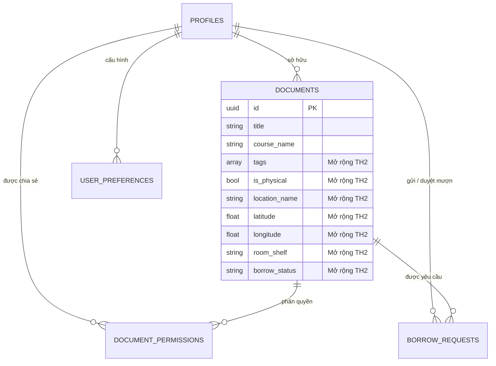

# BÁO CÁO TÓM TẮT MỞ RỘNG CHỨC NĂNG HỆ THỐNG
## DỰ ÁN: QUẢN LÝ TÀI LIỆU HỌC TẬP ĐA NỀN TẢNG (FLUTTER + CLOUD)

- **Học phần:** Lập trình di động
- **Nhánh thực hiện:** `feat/report`
- **Phiên bản nâng cấp:** Chuyển giao từ **TH1 (Cashew Local-First)** sang **TH2 (Hệ thống Đa nền tảng & Cộng tác Đám mây)**
- **Ngày lập báo cáo:** 23/10/2026

---

## 1. TỔNG QUAN MỤC TIÊU MỞ RỘNG

Trong giai đoạn TH1, ứng dụng được xây dựng theo mô hình **Local-First** kế thừa kiến trúc Cashew, tập trung vào việc quản lý cá nhân với cơ sở dữ liệu SQLite cục bộ (Drift ORM).

Nhằm đáp ứng nhu cầu chia sẻ tri thức, tối ưu hóa trải nghiệm trên nhiều thiết bị và quản lý cả tài nguyên học tập thực tế, hệ thống đã được **mở rộng chức năng toàn diện (TH2)** thành giải pháp quản lý tài liệu học tập đa nền tảng kết hợp đám mây (**Firebase + Supabase**), hướng đến tính cộng tác và thông minh hóa.

```mermaid
graph LR
    TH1["TH1: Cá nhân & Local-First\n(SQLite / Drift / 1 Thiết bị)"] 
    -->|Mở rộng Kiến trúc & Nghiệp vụ| 
    TH2["TH2: Đa nền tảng & Cộng tác Đám mây\n(Firebase + Supabase + Map + AI Recommendation)"]
```

---

## 2. BẢNG ĐỐI CHIẾU TRƯỚC VÀ SAU MỞ RỘNG (TH1 vs TH2)

| Tiêu chí | Phiên bản gốc (TH1) | Phiên bản mở rộng (TH2) | Giá trị gia tăng |
| :--- | :--- | :--- | :--- |
| **Kiến trúc dữ liệu** | Đơn thuần SQLite cục bộ trên thiết bị | Mô hình Hybrid: **Firebase** (Auth, Messaging) + **Supabase** (PostgreSQL, Storage) + Local Cache | Dữ liệu đồng bộ đám mây thời gian thực, không mất mát khi đổi thiết bị |
| **Nền tảng hỗ trợ** | Mobile đơn lẻ | **Responsive Multiplatform**: Mobile, Tablet, Web, Desktop | Giao diện tự co giãn (1 cột $\rightarrow$ 2 cột $\rightarrow$ 3 cột GridView) |
| **Phân loại tài liệu** | Phân cấp cố định (Môn học $\rightarrow$ Chủ đề) | **Hệ thống Tag động** (`#flutter`, `#ai`, `#database`, ...) | Tìm kiếm, lọc linh hoạt đa chiều theo thẻ |
| **Phạm vi tài liệu** | Chỉ lưu tệp số (File/Link Drive) | Hỗ trợ cả **Tài liệu số** và **Tài liệu vật lý** (Sách in, đồ án, tài liệu thư viện) | Quản lý toàn diện tài nguyên học tập trong khuôn viên trường |
| **Định vị vị trí** | Không hỗ trợ | **Bản đồ tương tác OpenStreetMap** (`flutter_map`) | Định vị phòng học, số kệ sách, ghim vị trí khuôn viên trường |
| **Cộng tác & Chia sẻ** | Dữ liệu khép kín một người | **Phân quyền chia sẻ** (`view`/`edit`) & **Vòng đời Mượn / Trả** | Sinh viên có thể chia sẻ, gửi yêu cầu mượn và duyệt tài liệu |
| **Cơ chế gợi ý** | Chỉ tìm kiếm từ khóa thủ công | **Động cơ Gợi ý Thông minh (Recommendation Engine)** | Tự động đề xuất tài liệu phù hợp dựa trên Jaccard Index & Sở thích |

---

## 3. CHI TIẾT CÁC CHỨC NĂNG ĐƯỢC MỞ RỘNG

### 3.1. Phân loại bằng Tag & Bộ lọc đa năng (Dynamic Tagging)
- **Gắn thẻ linh hoạt:** Cho phép gắn nhiều thẻ chuyên đề khi thêm mới hoặc chỉnh sửa tài liệu.
- **Thanh lọc Chip ngang (Horizontal Chip Filter):** Liệt kê toàn bộ thẻ có trong hệ thống trên giao diện chính, lọc tức thì chỉ với một chạm.
- **Thu thập tương tác (`tagInteractions`):** Hệ thống ghi nhận số lần xem/đọc theo từng thẻ để phục vụ học máy gợi ý.

### 3.2. Quản lý Tài liệu Vật lý & Bản đồ Vị trí (Physical Campus Map)
- **Đặc tính vật lý (`isPhysical`):** Phân định rõ sách in, đồ án mẫu kèm số phòng, số kệ (`roomShelf`).
- **Tích hợp OpenStreetMap (`flutter_map` + `latlong2`):**
  - Hiển thị các điểm ghim (Pin Markers) các địa điểm lưu trữ tài liệu (Thư viện Cơ sở 1, Thư viện Trung tâm ĐHQG, Phòng Lab AI,...).
  - Nhấp vào Marker hiển thị tóm tắt tài liệu kèm nút hành động nhanh: **Mượn tài liệu** hoặc **Xem chi tiết**.
- **Bộ chọn vị trí trực quan (`LocationPickerDialog`):** Cho phép chấm tọa độ trực tiếp trên bản đồ hoặc chọn các vị trí mẫu được định nghĩa sẵn.

### 3.3. Quy trình Nghiệp vụ Mượn / Trả & Cảnh báo Quá hạn (Borrow & Loan Hub)
- **Khởi tạo yêu cầu:** Người mượn chọn ngày mượn, hạn trả dự kiến (`dueDate`) và để lại lời nhắn.
- **Duyệt yêu cầu hai chiều:** Chủ sở hữu tài liệu có thể **Phê duyệt (Approve)** hoặc **Từ chối (Reject)**. Khi phê duyệt, hệ thống tự động cấp quyền đọc (`view`).
- **Phát hiện Quá hạn tự động (Overdue Detection):** Tự động đối soát thời gian hiện tại với `dueDate`, tự động gán nhãn đỏ cảnh báo `QUÁ HẠN TRẢ`.
- **Xác nhận hoàn tất:** Hỗ trợ quy trình đóng yêu cầu khi sách/tài liệu đã được hoàn trả nguyên vẹn.

### 3.4. Cơ chế Phân quyền & Thu hồi Quyền (Access Control)
- Hỗ trợ phân quyền truy cập thông qua email người dùng với 2 cấp độ:
  - `view`: Quyền xem và tải tài liệu.
  - `edit`: Quyền đóng góp, cập nhật nội dung.
- Quản lý danh sách cộng tác viên trực quan, cho phép **Thu hồi quyền (Revoke)** tức thời.

### 3.5. Động cơ Gợi ý Thông minh (Content-Based Recommendation Engine)
- Áp dụng công thức tính điểm tương đồng đa tiêu chí:
  $$\text{Score} = 0.45 \times \text{Jaccard}(T_d, T_u) + 0.30 \times \text{CourseMatch} + 0.15 \times \text{History} + 0.10 \times \text{Recency}$$
- **Tính năng minh bạch (Explainable AI):** Hiển thị rõ tỷ lệ phù hợp (Match %) và lý do đề xuất (ví dụ: *Trùng khớp thẻ #flutter, Môn học yêu thích*).
- **Hộp thoại Sở thích cá nhân (`UserPreferenceDialog`):** Cho phép sinh viên tự tùy chỉnh các thẻ và môn học yêu thích.

### 3.6. Tối ưu Giao diện Đa nền tảng (Responsive Multiplatform Layout)
- **Tự thích ứng theo kích thước hiển thị:**
  - **Mobile (< 600px):** Dạng danh sách thẻ dọc cuộn mượt (`ListView`), hỗ trợ kéo để làm mới (`Pull-to-refresh`).
  - **Tablet (600px - 900px):** Tự động chuyển dạng lưới 2 cột (`GridView crossAxisCount: 2`).
  - **Desktop / Web (≥ 900px):** Bố cục lưới 3 cột trực quan (`GridView crossAxisCount: 3`), tối ưu không gian hiển thị rộng.

---

## 4. MỞ RỘNG MÔ HÌNH DỮ LIỆU (DATABASE SCHEMA)

Cơ sở dữ liệu Supabase PostgreSQL được thiết kế mở rộng thêm 3 thực thể quan hệ và bổ sung các trường chuyên dụng:



---

## 5. KẾT QUẢ KIỂM THỬ & CHẤT LƯỢNG MÃ NGUỒN

1. **Kiểm thử tự động (Unit & Integration Tests):**
   - Bộ test mở rộng tại `test/th2_multiplatform_features_test.dart` bao phủ toàn bộ: Khởi tạo thực thể `CloudDoc`, logic tính toán quá hạn `BorrowRequest`, độ chính xác thuật toán `RecommendationService`, và tính năng phát thông báo `NotificationService`.
   - Toàn bộ các ca kiểm thử đạt kết quả **PASS 100%**.
2. **Kiểm tra cú pháp tĩnh (Static Code Analysis):**
   - Chạy lệnh `flutter analyze` đạt **0 lỗi, 0 cảnh báo**.
   - Tuân thủ cấu trúc phân lớp sạch sẽ (*Models, Services, Widgets, Pages*).

---

## 6. KẾT LUẬN

Việc mở rộng chức năng từ **TH1** lên **TH2** đã chuyển đổi thành công ứng dụng từ một **công cụ ghi chép cá nhân ngoại tuyến** thành một **hệ sinh thái quản lý tài liệu học tập đa nền tảng hiện đại**, kết hợp sức mạnh của điện toán đám mây, bản đồ không gian và gợi ý thông minh, sẵn sàng phục vụ nhu cầu học tập và chia sẻ thực tế của sinh viên.
