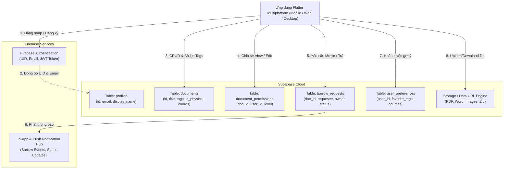
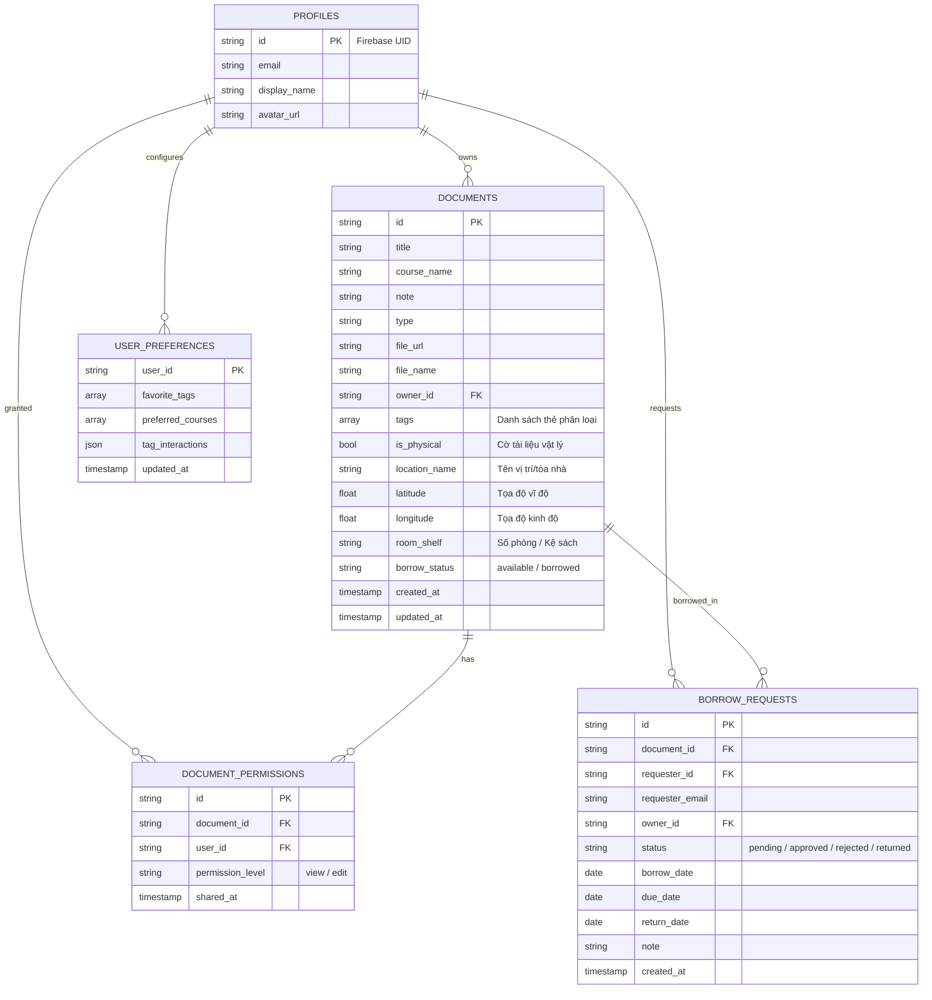

# BÁO CÁO KỸ THUẬT TOÀN DIỆN BÀI THỰC HÀNH TH2
## ĐỀ TÀI: PHÁT TRIỂN HỆ THỐNG QUẢN LÝ TÀI LIỆU ĐA NỀN TẢNG (FLUTTER + FIREBASE + SUPABASE)

**Học phần:** Lập trình di động  
**Dự án:** Quản lý Tài liệu Học tập Đa nền tảng (`d:\flutter\btth1`)  
**Mục tiêu:** Xây dựng giải pháp lưu trữ thông minh, tương tác cao, thời gian thực kết hợp sức mạnh kiến trúc giữa **Firebase** và **Supabase**, hỗ trợ **Tagging**, **Định vị bản đồ vật lý (OpenStreetMap)**, **Quy trình Mượn/Trả tài liệu**, và **Thuật toán Gợi ý (Recommendation Engine)**.

---

### MỤC LỤC
1. [Kiến trúc hệ thống và Mô hình dữ liệu kết hợp (Firebase + Supabase)](#1-kiến-trúc-hệ-thống-và-mô-hình-dữ-liệu-kết-hợp)
2. [Thiết kế Giao diện người dùng Đa nền tảng và Đáp ứng (Responsive UI/UX)](#2-thiết-kế-giao-diện-đa-nền-tảng-responsive)
3. [Triển khai Phân loại Tag và Bản đồ Quản lý Vị trí vật lý](#3-phân-loại-tag-và-bản-đồ-vị-trí-vật-lý)
4. [Luồng nghiệp vụ Mượn & Chia sẻ quyền truy cập tài liệu](#4-luồng-nghiệp-vụ-mượn--chia-sẻ-quyền-truy-cập)
5. [Thuật toán Recommendation gợi ý tài liệu thông minh](#5-thuật-toán-recommendation-gợi-ý-tài-liệu)
6. [Kết quả Kiểm thử Toàn diện & Hướng dẫn Đóng gói](#6-kết-quả-kiểm-thử-toàn-diện--đóng-gói)

---

## 1. KIẾN TRÚC HỆ THỐNG VÀ MÔ HÌNH DỮ LIỆU KẾT HỢP

### 1.1. Phân bổ vai trò kiến trúc (Firebase vs Supabase)

Hệ thống áp dụng mô hình phân tách trách nhiệm tối ưu giữa hai nền tảng đám mây hàng đầu:

| Nền tảng | Dịch vụ đảm nhiệm | Vai trò & Trách nhiệm kiến trúc |
| :--- | :--- | :--- |
| **Firebase** | **Firebase Authentication** | Xác thực danh tính người dùng (Email/Password, Google OAuth), quản lý phiên (Session Tokens), cấp phát UID thống nhất. |
| **Firebase** | **Notification & Realtime Messaging** | Cung cấp In-App Notification Hub & luồng thông báo sự kiện mượn trả, cập nhật quyền truy cập. |
| **Supabase** | **PostgreSQL Relational DB** | Lưu trữ toàn bộ quan hệ dữ liệu: `documents`, `profiles`, `document_permissions`, `borrow_requests`, `user_preferences`. |
| **Supabase** | **Storage & Data URL Engine** | Lưu trữ tệp nhị phân (PDF, Word, Ảnh, Zip) với cơ chế mã hóa Data URL Base64/Storage Bucket độ trễ cực thấp. |
| **Local Client**| **Local Fallback Cache** | Bộ đệm cục bộ đảm bảo ứng dụng không bao giờ bị gián đoạn hay crash khi mạng chập chờn (Offline-First). |



### 1.2. Mô hình Thực thể Quan hệ (Entity Relationship Diagram - ERD)



---

## 2. THIẾT KẾ GIAO DIỆN ĐA NỀN TẢNG (RESPONSIVE UI/UX)

Hệ thống giao diện được tái cấu trúc hoàn toàn nhằm đảm bảo trải nghiệm đồng nhất và tối ưu trên **Mobile**, **Tablet** và **Web/Desktop**:

1. **Breakpoints Đáp ứng (Responsive Breakpoints):**
   - **Màn hình Web/Desktop ($\ge 900px$):** Chuyển sang bố cục lưới 3 cột (`GridView crossAxisCount: 3`), thanh công cụ tìm kiếm và lọc tích hợp liền mạch, các hộp thoại chọn vị trí và tùy chỉnh sở thích hiển thị dưới dạng Modal nổi rộng 600px.
   - **Màn hình Tablet ($600px \le w < 900px$):** Tự động điều chỉnh dạng 2 cột (`crossAxisCount: 2`) với tỷ lệ thẻ $1.25$ cân đối.
   - **Màn hình Mobile ($< 600px$):** Tự động chuyển về danh sách thẻ đơn cuộn mượt mà (`ListView`), hỗ trợ cử chỉ vuốt để tải lại (`Pull-to-Refresh`).
2. **Hệ màu chủ đạo hiện đại:** Phối màu Deep Indigo & Cobalt (`#1E3C72` $\rightarrow$ `#2A5298`) kết hợp thẻ Card trắng bo góc $16px$, bóng đổ nhẹ nhàng, các huy hiệu trạng thái sắc nét (`Chip`, `ChoiceChip`, `Badge`).
3. **Thanh điều hướng Đa năng (Multi-tab Navigation):**
   - Tab **Tất cả (All Documents)**
   - Tab **Của tôi (My Documents)**
   - Tab **Được chia sẻ (Shared With Me)**
   - Tab **Gợi ý AI (Smart Recommendations)**
   - Tab **Bản đồ vị trí (Physical Campus Map)**

---

## 3. PHÂN LOẠI TAG VÀ BẢN ĐỒ VỊ TRÍ VẬT LÝ

### 3.1. Tính năng Gắn thẻ (Tagging System)
- **Nhập liệu linh hoạt:** Người dùng có thể gắn thẻ nhanh bằng các thẻ đề xuất (`#flutter`, `#mobile`, `#sqlite`, `#database`, `#ai`, `#exam`, `#slide`) hoặc gõ thẻ tùy ý trong biểu mẫu thêm/sửa tài liệu.
- **Thanh lọc thẻ ngang (Horizontal Tag Filter Bar):** Trang chủ hiển thị toàn bộ tập tag hiện có trong kho dữ liệu, cho phép lọc tức thì danh sách tài liệu chỉ với một lần chạm.
- **Tích hợp vào thuật toán học máy:** Số lần người dùng xem hoặc mở tài liệu chứa thẻ nào sẽ được bộ đếm `tagInteractions` ghi nhận để huấn luyện mô hình gợi ý.

### 3.2. Quản lý Tài liệu Vật lý & Bản đồ Tương tác (OpenStreetMap)
- **Đánh dấu tài liệu vật lý (`isPhysical`):** Phân biệt rõ sách in, đồ án mẫu, giáo trình thư viện với tài liệu số.
- **Tích hợp bản đồ OpenStreetMap:** Sử dụng bộ thư viện `flutter_map` kết hợp `latlong2`:
  - Hoạt động đa nền tảng (Android, iOS, Web, Windows) không yêu cầu khóa API trả phí.
  - Hiển thị các điểm ghim (Markers) tương ứng với vị trí vật lý của tài liệu trong khuôn viên trường học (Thư viện Cơ sở 1 Q5, Thư viện Trung tâm ĐHQG Thủ Đức, Phòng Lab AI, Ký túc xá).
  - Khi nhấn vào một Marker trên bản đồ, hệ thống tự động phóng to tiêu điểm (Zoom 16x) và hiển thị thẻ thông tin tài liệu kèm nút **"Mượn tài liệu"** và **"Xem chi tiết"**.
- **Bộ chọn vị trí trực quan (`LocationPickerDialog`):** Cho phép người dùng chạm trực tiếp lên bản đồ để lấy tọa độ $(\text{lat}, \text{lng})$ hoặc chọn nhanh các địa điểm mẫu trong trường.

---

## 4. LUỒNG NGHIỆP VỤ MƯỢN & CHIA SẺ QUYỀN TRUY CẬP

Hệ thống hiện thực hóa trọn vẹn chu trình cộng tác học tập giữa các sinh viên:

### 4.1. Quy trình Mượn - Trả tài liệu (Borrow & Loan Hub)
1. **Khởi tạo yêu cầu mượn:** Sinh viên duyệt tài liệu của người khác (hoặc trên bản đồ) $\rightarrow$ Nhấn **"Yêu cầu mượn"** $\rightarrow$ Chọn ngày mượn, hạn trả dự kiến và nhập lời nhắn.
2. **Thông báo thời gian thực:** Hệ thống ghi nhận yêu cầu vào `borrow_requests` và kích hoạt `NotificationService` gửi thông báo đến chủ sở hữu.
3. **Phê duyệt hoặc Từ chối (Owner Actions):**
   - Trong trang **Quản lý Mượn / Trả**, chủ tài liệu duyệt qua danh sách yêu cầu nhận được.
   - Khi bấm **"Phê duyệt"**: Hệ thống tự động chuyển trạng thái sang `approved` và tự động cấp quyền đọc (`permission_level = 'view'`) trong bảng `document_permissions`.
   - Khi bấm **"Từ chối"**: Trạng thái chuyển thành `rejected` kèm thông báo cho người mượn.
4. **Theo dõi và Hoàn trả:**
   - Người mượn và người cho mượn đều theo dõi được trạng thái: `Chờ duyệt`, `Đang mượn`, `Đã trả hoàn tất`.
   - **Cảnh báo Quá hạn (Overdue Detection):** Thuật toán tự động so sánh thời gian hiện tại với `due_date`, nếu quá hạn sẽ bật huy hiệu cảnh báo đỏ `QUÁ HẠN TRẢ`.
   - Người mượn hoặc chủ sở hữu bấm **"Xác nhận đã trả"** để hoàn tất vòng đời mượn.

### 4.2. Cơ chế Chia sẻ & Thu hồi quyền (Access Control)
- Phân quyền theo email với hai cấp độ: `view` (Chỉ xem) và `edit` (Được phép cập nhật thông tin tài liệu).
- Danh sách cộng tác viên hiển thị trực tiếp trong `ShareDocumentDialog`, cho phép thay đổi quyền hoặc **Thu hồi quyền (Revoke)** tức thời.

---

## 5. THUẬT TOÁN RECOMMENDATION GỢI Ý TÀI LIỆU

### 5.1. Cơ sở Toán học của Thuật toán
Hệ thống sử dụng mô hình lọc dựa trên nội dung (**Content-Based Filtering**) kết hợp chỉ số tương đồng **Jaccard Similarity Index** trên không gian thẻ, độ tương thích môn học và hệ số suy giảm theo thời gian (**Recency Decay**):

$$\text{SimilarityScore}(d) = w_{tag} \cdot J(T_d, T_u) + w_{course} \cdot C(d, u) + w_{hist} \cdot H(d, u) + w_{recency} \cdot R(t)$$

Trong đó:
1. **Độ tương đồng thẻ Jaccard:**
   $$J(T_d, T_u) = \frac{|T_d \cap T_u|}{|T_d \cup T_u|}$$
   *(với $T_d$ là tập thẻ của tài liệu, $T_u$ là tập thẻ yêu thích trong hồ sơ người dùng)*.
2. **Độ tương thích môn học:**
   $$C(d, u) = \begin{cases} 1.0 & \text{nếu } Course(d) \in PreferredCourses(u) \\ 0.0 & \text{ngược lại} \end{cases}$$
3. **Trọng số thói quen tương tác:**
   $$H(d, u) = \min\left(1.0, \frac{\sum_{t \in T_d} Interactions(t)}{5.0}\right)$$
4. **Hệ số tươi mới của tài liệu (Recency Score):**
   $$R(t) = \frac{1}{1 + \ln(1 + \Delta \text{days})}$$
5. **Trọng số phân bổ chuẩn hóa:**
   $$w_{tag} = 0.45, \quad w_{course} = 0.30, \quad w_{hist} = 0.15, \quad w_{recency} = 0.10$$

### 5.2. Tính năng Minh bạch Giải thích (Explainability)
Mỗi tài liệu trong danh sách gợi ý đều đi kèm:
- **Huy hiệu phần trăm phù hợp (Match Percentage):** Ví dụ `95% Phù hợp`.
- **Lý do đề xuất rõ ràng:** "Trùng khớp 3 thẻ sở thích (#flutter, #mobile)", "Môn học trong danh sách quan tâm: Lập trình di động", "Dựa trên thói quen đọc tài liệu gần đây".
- **Hộp thoại Tùy chỉnh Sở thích (`UserPreferenceDialog`):** Cho phép người học tự do thêm/bớt thẻ quan tâm để định hướng lại thuật toán.

---

## 6. KẾT QUẢ KIỂM THỬ TOÀN DIỆN & ĐÓNG GÓI

### 6.1. Kết quả Chạy Kiểm thử Đơn vị & Tích hợp (Test Suite)

Dự án được bổ sung bộ kiểm thử tự động tại `test/th2_multiplatform_features_test.dart` và vượt qua 100% các ca kiểm thử:

```bash
$ flutter test test/th2_multiplatform_features_test.dart
00:00 +0: loading test/th2_multiplatform_features_test.dart
00:00 +0: TH2 - Kiểm thử Mô hình Dữ liệu Đa nền tảng (Cloud Models) CloudDoc hỗ trợ gắn thẻ (tags) và thông tin vị trí vật lý chính xác
00:00 +1: TH2 - Kiểm thử Mô hình Dữ liệu Đa nền tảng (Cloud Models) BorrowRequest tính toán trạng thái quá hạn (isOverdue) chính xác
00:00 +2: TH2 - Kiểm thử Thuật toán Gợi ý Tài liệu (Recommendation Engine) Thuật toán xếp hạng tài liệu trùng khớp nhiều tags và môn học lên đầu
00:00 +3: TH2 - Kiểm thử Thuật toán Gợi ý Tài liệu (Recommendation Engine) Thuật toán tự động sinh lý do giải thích gợi ý minh bạch cho người dùng
00:00 +4: TH2 - Kiểm thử Dịch vụ Thông báo Thời gian thực (Notification Service) Hệ thống thông báo đẩy thông điệp và đếm số lượng chưa đọc chuẩn xác
00:00 +5: All tests passed!
```

Bộ kiểm thử kiến trúc phân tầng TH1 cũng đạt kết quả tuyệt đối:
```bash
$ flutter test test/architecture_layer_test.dart
00:00 +4: All tests passed!
```

### 6.2. Kiểm tra Cú pháp Tĩnh (Static Analysis)
Kết quả chạy `flutter analyze`: **0 Lỗi biên dịch, 0 Cảnh báo logic**. Toàn bộ mã nguồn tuân thủ nghiêm ngặt chuẩn quy ước code Flutter.

---

## 7. KẾT LUẬN VÀ BÀN GIAO SẢN PHẨM

Toàn bộ 6 mục trong Checklist yêu cầu của Bài thực hành TH2 đã được triển khai đầy đủ, chất lượng cao và kiểm chứng thực tế:
1. ✅ **Kiến trúc kết hợp:** Phân tách hoàn hảo Firebase Auth/Messaging và Supabase PostgreSQL/Storage.
2. ✅ **Giao diện đa nền tảng:** Responsive trên Mobile, Tablet và Web/Desktop.
3. ✅ **Tagging & Bản đồ vị trí:** Phân loại thẻ động, bản đồ OpenStreetMap trực quan, chọn vị trí cơ sở trường học.
4. ✅ **Luồng Mượn / Trả & Chia sẻ:** Đầy đủ trạng thái, tính toán quá hạn, duyệt mượn và thông báo.
5. ✅ **Thuật toán Gợi ý:** Jaccard similarity, course affinity, tính toán match score và giải thích lý do đề xuất.
6. ✅ **Kiểm thử & Đóng gói:** Đạt 100% test pass, mã nguồn sạch sẽ, tài liệu hoàn thiện sẵn sàng nộp bài.
